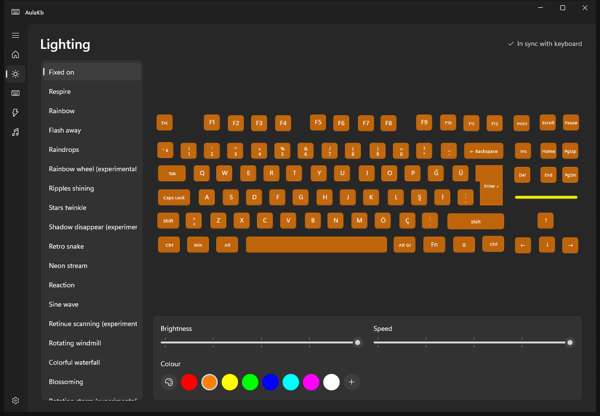
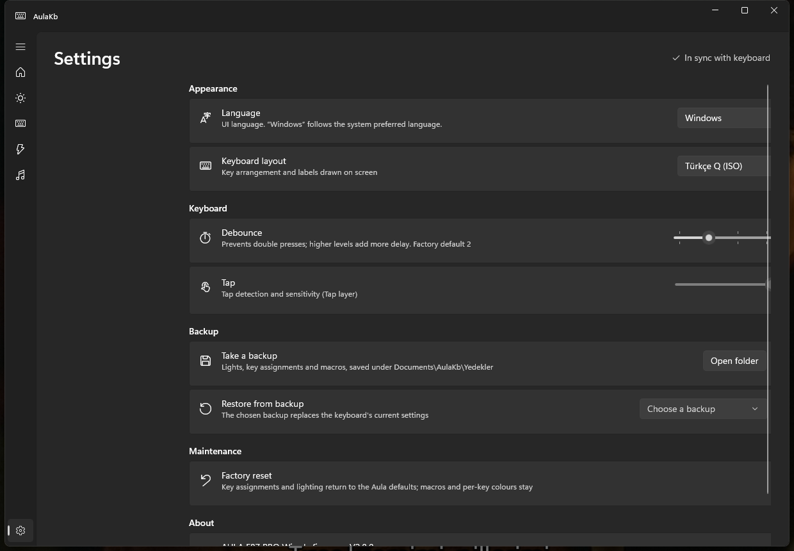

# AulaKb

An open-source configuration app for the **Aula F87 Pro** (wired, `258A:010C`), built with
WinUI 3 so it looks and moves like Windows 11 itself.

- **Lighting:** all hardware effects (including four the vendor tool hides), brightness, speed,
  single colour or colourful, per-key colours for Self-define, and a live preview.
- **Keys:** remap any key on all four layers (default, FN1, FN2, Tap) to a key or combination,
  mouse button, media key, macro, Windows shortcut, or disable it.
- **Macros:** record with real timing, edit delays, store on the keyboard.
- **Music mode:** system audio (WASAPI loopback) drives the LEDs, with the vendor tool's ten
  modes rebuilt from captures of its output, previewed live on the on-screen keyboard.
- **On-screen keyboard:** Turkish Q, UK ISO and US ANSI drawings; picked automatically from the
  active Windows keyboard layout.
- **Self-define:** paint keys by clicking or dragging across them; save your own colours.
- **Macros:** insert keys into a recorded macro, import/export macros as JSON.
- **Profiles:** save everything on the keyboard under a name, apply, rename, duplicate,
  export/import (`.aulakb`).
- **Tray:** closing keeps AulaKb in the notification area (music mode keeps running); optional
  start with Windows.
- **Settings:** debounce, tap, factory reset.
- **CLI:** `aulakb info | verify | dump | backup | restore | effect | factory-reset`.
- **Languages:** Turkish and English. The UI follows the Windows preferred language by default
  (English is the fallback) and can be switched on the Settings page.

The protocol is documented in [docs/PROTOCOL.md](docs/PROTOCOL.md).

## Screenshots





## Install

Grab `AulaKb-Setup-*.exe` from
[Releases](https://github.com/Lowell137/aulakb-win/releases) and run it — it installs per-user
(no admin prompt needed). The setup asks whether **AulaKb should start with Windows**; the option
can also be changed later from the installer's maintenance mode (re-run the setup and
Uninstall).

## Safety

AulaKb only sends the configuration commands listed in the protocol document and refuses
anything else in code (`AulaKeyboard.AllowedCommands`). It has **no firmware update path**: it
never talks to the SinoWealth bootloader. Persistent tables are validated (`5A A5` trailers)
before they are written, and every write is read back.

## Build

Requirements: Windows 10/11, .NET 8 SDK.

```
dotnet build src/AulaKb.App/AulaKb.App.csproj -p:Platform=x64
dotnet build src/AulaKb.Cli/AulaKb.Cli.csproj
```

The app is unpackaged and self-contained (Windows App SDK 2.5.1), so the output folder runs as is.

## Layout

- `src/AulaKb.Core` — HID access (`hid.dll`), protocol, data models, factory tables.
- `src/AulaKb.App` — WinUI 3 app.
- `src/AulaKb.Cli` — command line tool.

Linux support is planned through hidraw in Core and Uno Platform for the UI.
